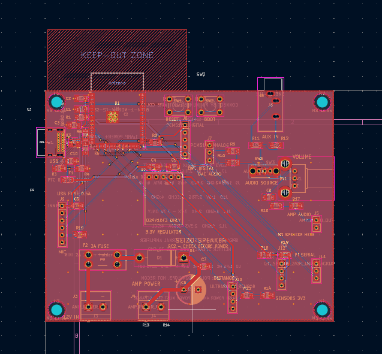
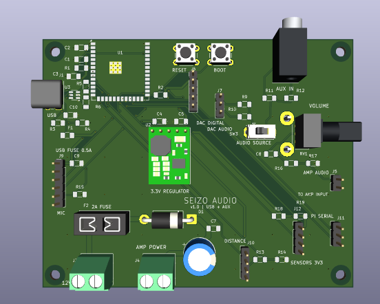

# Seizo-Noise

## What I made

Seizo Noise is a PCB I designed for my robotic arm. The main reason I made it was that I wanted the arm to be able to talk and take in voice commands. I thought it would be really cool to say, “Hey, Seizo,” and have it respond with something like, “Yeah, what’s up?” I also want it to be able to play music.

It’s a big PCB with USB-C and connections for a separate microphone module and amplifier module. It also has more connectors for sensors and other parts of my robotic arm. The goal is to bring these connections together and make the whole setup simpler.

## What it does

The board is designed to receive audio from my Raspberry Pi or laptop through the headphone output, using an AUX cable plugged directly into the PCB. It has a switch to choose the audio source and a knob to adjust the volume.

It also connects to a microphone module, an amplifier module, and additional sensors. The amplifier connects to the speaker. Eventually, I want the microphone and software to let me talk to the robotic arm and have it respond. That voice interaction is still something I need to make work and test.

## Why I made it

I made it because constantly running motor commands and being on my phone to train the arm has gotten really annoying. I wanted to simplify that so I could eventually give it instructions by talking instead.

I also wanted one board to bring the audio and sensor connections together instead of having everything spread out. Making the robot easier to use is the main reason, but having it talk back would also be way cooler, in my opinion.

The AUX input also means it isn’t only for the arm. I want to connect my laptop and use the speaker setup for that too.

## My work and what I learned

I worked on the schematic, added components and connections, arranged the PCB, and routed it. I worked through a ton of errors, especially when ERC and DRC kept failing. That got really annoying at some points, but figuring out what the errors meant helped me learn.

Week 1 was mostly about messing around and learning how KiCad works. This project was more about understanding specific design rules, footprints, trace widths, and filling areas of the PCB with ground copper.

I learned that getting the schematic connected is only part of the work. I also had to think about where the components go, whether the footprints match, and whether the routing follows the rules. Working through those problems made me understand the whole process much better.

## Parts and current progress

I haven’t personally checked many of the individual parts yet. The connections I’m most familiar with are the headphone outputs on my laptop and Raspberry Pi. I chose an AUX input because those are simple to reuse, and it lets the board work with either device instead of being only for the robotic arm.

The schematic and routing work are finished in KiCad. I still need to finish checking the parts and purchasing choices, get the PCB made, solder it, and test the actual hardware. Nothing has been manufactured or assembled yet, so I haven’t tested the finished board playing audio or recording through the microphone.

## Help and sources

I used tutorials, datasheets, and KiCad’s tools throughout the project. I also talked to friends at school for help understanding things like different modules, voltage requirements, capacitor selection, and how to make the design safer.

ERC and DRC were especially helpful because they pointed out errors that I would have struggled to find myself. I used them a ton while working through the schematic and routing.

I also used AI to help plan the project, research components, explain errors, and give me instructions. ChatGPT directly edited project files too, including changes to the layout, routing, footprints, and labels when I got stuck. I did hands-on schematic and routing work myself, but the final files also include those AI-made changes.

## Project screenshots

These are CAD screenshots, not photographs of assembled hardware. They show the original Seizo Audio v1.0 carrier. The lower-cost purchase option below uses a wired regulator rather than the pictured Pololu module.

## Design files

| File | Link |
| --- | --- |
| KiCad schematic | [speakerpcb.kicad_sch](hardware/speakerpcb.kicad_sch) |
| PCB layout | [speakerpcb.kicad_pcb](hardware/speakerpcb.kicad_pcb) |
| Complete KiCad project | [speakerpcb.kicad_pro](hardware/speakerpcb.kicad_pro) |
| Board rules | [speakerpcb.kicad_dru](hardware/speakerpcb.kicad_dru) |
| Included footprints | [Seizo_Audio.pretty](hardware/Seizo_Audio.pretty) |
| Included symbols | [Seizo_Audio.kicad_sym](hardware/Seizo_Audio.kicad_sym) |
| Original assembly instructions | [Assembly.md](docs/Assembly.md) |
| Original connector pin maps | [Connections.md](docs/Connections.md) |
| Lower-cost assembly option | [Low_cost_assembly.md](docs/Low_cost_assembly.md) |
| Native schematic check | [ERC.rpt](validation/ERC.rpt) |
| Native board and schematic-parity check | [DRC.rpt](validation/DRC.rpt) |
| Gerbers and drills | [Seizo_Audio_Gerbers.zip](fabrication/Seizo_Audio_Gerbers.zip) |

Open `hardware/speakerpcb.kicad_pro` with its bundled libraries. The existing ERC/DRC reports apply to the published carrier CAD. No PCB copper or schematic nets were changed in this purchasing update, and those reports do not validate the new wired regulator assembly or physical operation.

## Current hardware and purchase scope

**The $3.95 Adafruit 4711 regulator is NOT a drop-in replacement for the original Pololu footprint.** Leave the Pololu and its socket uninstalled. Use three short insulated wires: carrier U2 pad 3 to Vin, pad 4 to GND, and pad 5 to 3V on Adafruit 4711. Follow the [assembly option](docs/Low_cost_assembly.md) before assembling or powering. Never connect this regulator to 12V.

| Item | Current selection |
| --- | --- |
| Carrier PCB | Existing 100 x 80mm, two-layer Seizo Audio v1.0 |
| Controller | Exact bare ESP32-S3-WROOM-1-N8R8, sourced separately from Mouser |
| 3.3V supply | Adafruit 4711 breakout wired to existing U2 pads; original CAD model remains Pololu |
| Main power terminals | On Shore OSTTC022162, 5.08mm pitch, two pieces |
| Playback | Pi/laptop AUX output, source selector and volume control |
| Microphone | Adafruit 3421 SPH0645LM4H, wired to J9 by signal |
| Amplifier | ShillehTek TPA3118 mono module |
| Speaker | One NEW Visaton FR 10 F - 4 OHM, 20W rated |
| Amplifier supply | Tri-Mag L6R30-120, 12V 2.5A, plus barrel adapter |
| Deferred equipment | PCM5102 DAC and additional sensors, as in the previous initial-build plan |
| Physical status | Not assembled, powered or audio-tested |

## Bill of materials

**Estimated selected-parts subtotal: $68.38.** This includes the new speaker, required ESP32, short-wiring pack and barrel adapter. The 30-line DigiKey portion is $55.11. The ESP32 is $6.28 from Mouser and the amplifier is $6.99 from ShillehTek.

The owner's separate $4 PCB allowance brings this to $72.38 before tax, delivery, tariffs and remaining accessories. AUX/USB cables, enclosure, mounting and insulation costs are not included or assumed free. The owner's roughly $20 tax/shipping allowance is not a checkout quote. See [Budget.md](purchasing/Budget.md).

New and major component listings were reviewed on October 22, 2026. Mouser listed the exact ESP32-S3-WROOM-1-N8R8 in stock at $6.28 on October 22, 2026; confirm final stock, shipping and tariffs at checkout. Other small-part prices are retained from earlier catalog checks. The user's reported $83 cart has not been inspected; this is not a claim to have corrected that live cart.

| References | Qty | Item / exact part | Unit USD | Line USD | Supplier |
| --- | ---: | --- | ---: | ---: | --- |
| External speaker | 1 | 4-ohm loudspeaker - Visaton FR 10 F - 20W (FR 10 F - 4 OHM) | 11.71 | 11.71 | [DigiKey](https://www.digikey.com/en/products/detail/visaton-gmbh-co-kg/FR-10-F-4-OHM/10650582) |
| U1 | 1 | ESP32-S3-WROOM-1-N8R8 bare module (ESP32-S3-WROOM-1-N8R8) | 6.28 | 6.28 | [Mouser](https://www.mouser.com/en/ProductDetail/Espressif-Systems/ESP32-S3-WROOM-1-N8R8) |
| U2 | 1 | 3.3V regulator breakout - wired assembly (4711) | 3.95 | 3.95 | [DigiKey](https://www.digikey.com/en/products/detail/adafruit-industries-llc/4711/13162412) |
| U3 | 1 | USB data ESD protector (USBLC6-2SC6) | 0.54 | 0.54 | [DigiKey](https://www.digikey.com/en/products/detail/stmicroelectronics/USBLC6-2SC6/1040559) |
| J1 | 1 | USB-C receptacle (USB4085-GF-A) | 0.91 | 0.91 | [DigiKey](https://www.digikey.com/en/products/detail/gct/USB4085-GF-A/9859733) |
| J8 | 1 | Stereo AUX input jack (SJ1-3533NG) | 1.69 | 1.69 | [DigiKey](https://www.digikey.com/en/products/detail/same-sky-formerly-cui-devices/SJ1-3533NG/738701) |
| J3 J4 | 2 | Two-position power terminal block (OSTTC022162) | 0.58 | 1.16 | [DigiKey](https://www.digikey.com/en/products/detail/on-shore-technology-inc/OSTTC022162/614558) |
| F1 | 1 | USB resettable fuse (1206L050/15YR) | 0.68 | 0.68 | [DigiKey](https://www.digikey.com/en/products/detail/littelfuse-inc/1206L050-15YR/2486168) |
| F2 | 1 | MINI blade fuse holder (3568) | 1.31 | 1.31 | [DigiKey](https://www.digikey.com/en/products/detail/keystone-electronics/3568/2137306) |
| F2 insert | 1 | 2A MINI blade fuse (0297002.WXNV) | 0.39 | 0.39 | [DigiKey](https://www.digikey.com/en/products/detail/littelfuse-inc/0297002-WXNV/124900) |
| D1 | 1 | Reverse-polarity diode (1N5822) | 0.71 | 0.71 | [DigiKey](https://www.digikey.com/en/products/detail/taiwan-semiconductor-corporation/1N5822/7366597) |
| RV1 | 1 | Volume potentiometer (PTV09A-2020F-A103) | 1.23 | 1.23 | [DigiKey](https://www.digikey.com/en/products/detail/bourns-inc/PTV09A-2020F-A103/3781098) |
| SW3 | 1 | Audio source selector (OS102011MS2QN1) | 0.80 | 0.80 | [DigiKey](https://www.digikey.com/en/products/detail/c-k/OS102011MS2QN1/411602) |
| SW1 SW2 | 2 | RESET and BOOT buttons (B3F-1000) | 0.35 | 0.70 | [DigiKey](https://www.digikey.com/en/products/detail/aratas-america-llc/B3F-1000/33150) |
| C1 C5 | 2 | 10uF ceramic capacitor (CL31A106KAHNFNE) | 0.25 | 0.50 | [DigiKey](https://www.digikey.com/en/products/detail/samsung-electro-mechanics/CL31A106KAHNFNE/3888696) |
| C2 C7 C9 C10 | 4 | 100nF ceramic capacitor (CL31B104KBCNNNC) | 0.14 | 0.56 | [DigiKey](https://www.digikey.com/en/products/detail/samsung-electro-mechanics/CL31B104KBCNNNC/3886675) |
| C3 C4 | 2 | 1uF ceramic capacitor (CL31B105KBHSNNE) | 0.24 | 0.48 | [DigiKey](https://www.digikey.com/en/products/detail/samsung-electro-mechanics/CL31B105KBHSNNE/3891179) |
| C6 | 1 | 470uF electrolytic capacitor (EEU-FR1E471) | 1.06 | 1.06 | [DigiKey](https://www.digikey.com/en/products/detail/panasonic-industry/EEU-FR1E471/2433553) |
| C8 | 1 | 2.2uF audio coupling capacitor (CL31B225KAHNNNE) | 0.21 | 0.21 | [DigiKey](https://www.digikey.com/en/products/detail/samsung-electro-mechanics/CL31B225KAHNNNE/3886730) |
| R1 R2 R13 R17 | 4 | 10k resistor (RC1206FR-0710KL) | 0.11 | 0.44 | [DigiKey](https://www.digikey.com/en/products/detail/yageo/RC1206FR-0710KL/731430) |
| R3 R4 | 2 | 5.1k resistor (RC1206FR-075K1L) | 0.10 | 0.20 | [DigiKey](https://www.digikey.com/en/products/detail/yageo/RC1206FR-075K1L/728947) |
| R5 R6 | 2 | 22 ohm resistor (RC1206FR-0722RL) | 0.11 | 0.22 | [DigiKey](https://www.digikey.com/en/products/detail/yageo/RC1206FR-0722RL/728687) |
| R9 R10 R11 R12 R18 R19 | 6 | 4.7k resistor (RC1206FR-074K7L) | 0.10 | 0.60 | [DigiKey](https://www.digikey.com/en/products/detail/yageo/RC1206FR-074K7L/728887) |
| R14 | 1 | 18k resistor (RC1206FR-0718KL) | 0.10 | 0.10 | [DigiKey](https://www.digikey.com/en/products/detail/yageo/RC1206FR-0718KL/731539) |
| R15 | 1 | 100k resistor (RC1206FR-07100KL) | 0.10 | 0.10 | [DigiKey](https://www.digikey.com/en/products/detail/yageo/RC1206FR-07100KL/728492) |
| R16 | 1 | 6.8k resistor (RC1206FR-076K8L) | 0.10 | 0.10 | [DigiKey](https://www.digikey.com/en/products/detail/yageo/RC1206FR-076K8L/729028) |
| J5 J6 J7 J9 J10 J11 J12 | 1 | 40-pin breakaway header strip (PRPC040SAAN-RC) | 1.23 | 1.23 | [DigiKey](https://www.digikey.com/en/products/detail/sullins-connector-solutions/PRPC040SAAN-RC/2775214) |
| External J9 | 1 | I2S microphone breakout (3421) | 6.95 | 6.95 | [DigiKey](https://www.digikey.com/en/products/detail/adafruit-industries-llc/3421/6691114) |
| External J4 J5 | 1 | Mono amplifier module (ST-HLHQRTMBQEIH) | 6.99 | 6.99 | [ShillehTek](https://shillehtek.com/products/tpa3118-pbtl-single-digital-amplifier-board-1x60w) |
| External supply | 1 | 12V amplifier power supply (L6R30-120) | 10.33 | 10.33 | [DigiKey](https://www.digikey.com/en/products/detail/tri-mag-llc/L6R30-120/7682642) |
| REGULATOR_AND_SHORT_POWER_WIRING | 1 | 22 AWG insulated wire - 1m ten-conductor ribbon (6180) | 4.25 | 4.25 | [DigiKey](https://www.digikey.com/en/products/detail/adafruit-industries-llc/6180/26690472) |
| 12V_ADAPTER | 1 | Female 2.1mm DC barrel to screw-terminal adapter (368) | 2.00 | 2.00 | [DigiKey](https://www.digikey.com/en/products/detail/adafruit-industries-llc/368/5629434) |

| **Selected-parts subtotal** | | | | **68.38** | |

## Import files

[Half-Life BOM](BOM.csv) and [durable component list](purchasing/Selected_components.csv) contain the same 32 priced rows with purposes. [DigiKey CSV](purchasing/Seizo_Noise_DigiKey.csv) has 30 rows, with the speaker first and no ESP32. [Other suppliers](purchasing/Other_suppliers.csv) lists the ESP32 and amplifier separately.

The speaker's exact DigiKey SKU is **2056-FR10F-4OHM-ND**. Its cart reference is `SPEAKER_4OHM_20W`. An amplifier module is not the loudspeaker. The previous file already included the speaker SKU; the reason it was missing from the user's cart was not established.

Use an empty project cart or remove obsolete/duplicate lines before importing. Reimporting does not establish that existing cart items were removed. Verify 30 DigiKey rows, including one speaker, before checkout. In Half-Life verify 32 parts and the prices before saving; a platform sync can overwrite root `BOM.csv`. No live cart or authenticated Half-Life import was run by this update.

## Sources and records

- [Original development journal](JOURNAL.md), synced by Half-Life. Entries and hours were not changed.
- [Current component selection](purchasing/Selected_components.csv), [budget](purchasing/Budget.md), and [status](purchasing/BOM_status.json).
- [Earlier engineering requirements](purchasing/BOM_engineering.csv) and [previous selection](purchasing/Selected_components_previous.csv) are historical records, not current shopping lists.
- [Adafruit regulator](https://www.adafruit.com/product/4711), [terminal manufacturer drawing](https://www.on-shore.com/wp-content/uploads/OSTTCXX2162.pdf), and supplier links in the BOM support the new selections.
- [CAD import provenance](docs/import_provenance.json) and existing native checks under `validation/`.
- AI assistance was used for parts research, CSV formatting and technical assembly notes. The six owner-approved narrative sections above remain unchanged. No unaided research or physical testing is claimed.
